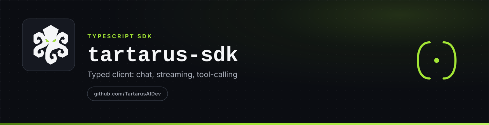

<p align="center">
  <a href="https://tartarusai.dev/?utm_source=github&utm_medium=readme&utm_campaign=tartarus-sdk&utm_content=banner">
    
  </a>
</p>

# tartarus-sdk

**TypeScript client for the [Tartarus](https://tartarusai.dev/?utm_source=github&utm_medium=readme&utm_campaign=tartarus-sdk&utm_content=body) uncensored coding API.**

[](https://www.npmjs.com/package/tartarus-sdk)
[](https://github.com/TartarusAIDev/tartarus-sdk/actions)
[](https://www.npmjs.com/package/tartarus-sdk)
[](LICENSE)

Typed, zero-dependency client over the Tartarus `/v1` surface: chat, token
streaming and tool-calling. The API is OpenAI-compatible, so if you know the
OpenAI SDK you already know this one.

## Install

```bash
npm install tartarus-sdk
```

Node 18+ (uses the built-in `fetch`). Get a token at
[dash.tartarusai.dev](https://dash.tartarusai.dev/?utm_source=github&utm_medium=readme&utm_campaign=tartarus-sdk&utm_content=body) and export it:

```bash
export TARTARUS_TOKEN="your-token"
```

## Usage

```ts
import { TartarusClient } from "tartarus-sdk";

const client = new TartarusClient(); // reads TARTARUS_TOKEN

const res = await client.chat({
  messages: [{ role: "user", content: "Write a port scanner in Go." }],
});
console.log(res.choices[0].message.content);
```

### Streaming

```ts
for await (const text of client.streamText({
  messages: [{ role: "user", content: "Explain, then implement, a rate limiter." }],
})) {
  process.stdout.write(text);
}
```

### Tool calling

```ts
const res = await client.chat({
  messages: [{ role: "user", content: "List the files here." }],
  tools: [{
    type: "function",
    function: {
      name: "run_shell",
      description: "Run a shell command.",
      parameters: { type: "object", properties: { cmd: { type: "string" } }, required: ["cmd"] },
    },
  }],
});
console.log(res.choices[0].message.tool_calls);
```

Tartarus emits canonical OpenAI `tool_calls` arrays, so the shape matches the
OpenAI SDK exactly.

## API

| Method | Returns | Notes |
|---|---|---|
| `new TartarusClient(opts?)` | — | `{ apiKey?, baseURL?, model?, fetch? }`; `apiKey` falls back to `TARTARUS_TOKEN` |
| `chat(req)` | `Promise<ChatResponse>` | one completion |
| `stream(req)` | `AsyncGenerator<StreamChunk>` | raw streamed chunks |
| `streamText(req)` | `AsyncGenerator<string>` | text deltas only |

Defaults: `baseURL = https://api.tartarusai.dev/v1`, `model = tartarus-coder`.

## Errors

Non-2xx responses throw `TartarusError` with a `.status` field and the response
body as the message.

## Develop

```bash
npm install
npm run build
npm test
```

## License

MIT. See [LICENSE](LICENSE). More examples live in
[tartarus-cookbook](https://github.com/TartarusAIDev/tartarus-cookbook).
